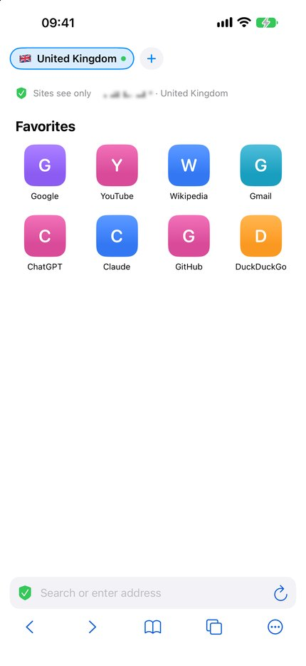
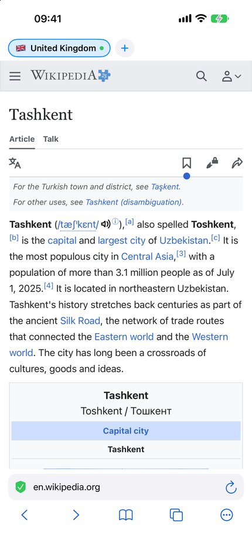
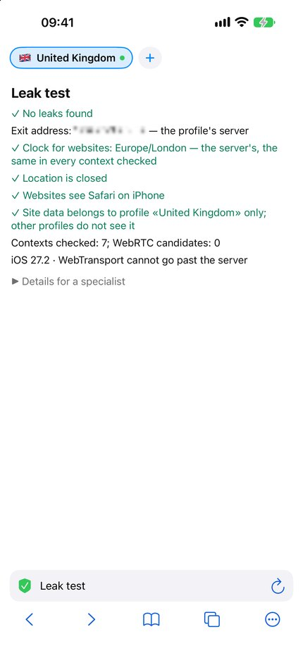
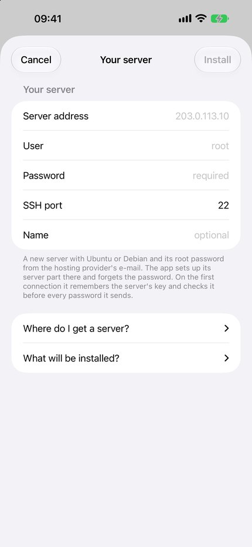
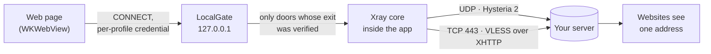

<p align="center">
  
</p>

<h1 align="center">IP Browser</h1>

<p align="center">
  <b>An iPhone browser that opens every website from your own server's IP address.<br>Pages and downloads leave only from the server you chose; if it is unavailable, the browser waits.</b>
</p>

<p align="center">
  <a href="../../actions/workflows/ci.yml"></a>
  
  
  
  
  <a href="LICENSE"></a>
  <a href="https://opensource.org/license/agpl-v3"></a>
</p>

<p align="center">
  <a href="#quick-start">Quick start</a> ·
  <a href="#how-it-works">How it works</a> ·
  <a href="#security-model">Security model</a> ·
  <a href="#your-server">Your server</a> ·
  <a href="#faq">FAQ</a> ·
  <a href="README.ru.md">Русский</a>
</p>

<p align="center">
  
  
  
  
</p>
<p align="center"><sub>The server's address is blurred in the screenshots.</sub></p>

---

## Why

Some services let you in only from one IP address: an office allowlist, a hosting panel, an account that locks itself when
the address changes. Others show what they show by country. What you want then is narrow and strict: **one browser that
always uses one address — your server's — never your own, and keeps those logins apart from everything else**, while the rest
of the phone stays as it is.

IP Browser is that browser. You give it a server (any small VPS), it sets the server up by itself in about half a minute, and
from then on every page it opens leaves from that server's address — or does not leave at all.

## Features

- 🧭 **A browser first.** Start page with favorites and recent sites, tabs with previews, bookmarks and history (on the phone
  only), find on page, share, downloads. Server, protection and the rest live in **Settings**.
- 🔒 **One address, enforced.** Web pages and downloads go through the server you chose. The connection core inside the app
  has no direct route to the internet and WebKit has no fallback: if the verified route is unavailable, the browser waits.
- ⚡ **Your server in half a minute.** Type the server's address and root password, tap **Install**. The app connects over
  SSH, installs its server part, gets a certificate, and forgets the password. Measured on a fresh Debian 13 VPS: 30 seconds.
- 🔁 **Two connections, switched for you.**
  **UDP** — Hysteria 2 with port hopping; **TCP** — VLESS Encryption (ML-KEM-768) over XHTTP on TCP 443, next to a small
  website with its own certificate. Each must prove it leaves from the server's address before it may carry a page. If UDP
  stops while you browse, new pages move to TCP by themselves (≈2 s for a new site).
- 🗂️ **A profile per server — separate browsers in one app.** 🇬🇧 United Kingdom, 🇫🇮 Finland, 🇺🇸 USA… named by their
  country automatically. Each has its own sign-ins, cookies and site data, tabs, favorites, history and clock; a profile has
  no cookies or storage of another (the device's own traits are the same in all of them, as in Safari's profiles). Switch at
  the top with one tap.
- 🌍 **Looks local, not just routed.** Websites see the server's time zone in windows, frames and the Blob workers a page
  creates (a site's service worker and workers loaded from a script file see the phone's zone — [measured](docs/LEAKS.md)),
  Safari's own user agent, and «location denied».
- 🧪 **Leak test built in.** *Settings → Leak test* checks WebRTC, WebTransport, passkeys, the clock in every context, the
  location answer, and compares the address websites see with your server's.
- 📶 **Wi-Fi or mobile.** The rest of the phone keeps its own connection. On IPv6-only (NAT64) networks the app dials the address iOS synthesizes for
  the server; both connections were proven through a lab NAT64 (64:ff9b::/96), not yet on a physical iPhone in such a network.
- 🤝 **Share access.** A key or QR code for another device; revoke it later from the app.
- 🙈 **No accounts, no analytics, no ads, no servers of ours.** The app talks to your server and the sites you open.

## Quick start

1. **Get the app.** It is not in the App Store yet: today it is built from source on a Mac with Xcode
   ([how](#build-from-source)) and installed on your own iPhone. App Store: coming soon.
2. **Have a key? You are done.** Someone running an IP Browser server can give you a key or a QR code:
   *Servers → Add by key or QR*. No server of your own needed.
3. **Or get a server.** Any VPS with Ubuntu 22.04/24.04 or Debian 12/13, one public IPv4, 1 GB RAM — usually 3–6 $ a month.
   Choose the country you want websites to see, and check that the geo-IP services agree on it ([why](#faq)).
4. **Install on it.** *Servers → Install on my server* → address, password → **Install**. The user can stay empty (`root`);
   a user with `sudo` works too.
5. **Browse.** The profile turns green: «Sites see only &lt;your server&gt;». Open anything; check *Settings → Leak test*.

Can't reach your server over SSH from your network? Open the server's **web console** in your hosting account and run the
installer this version of the app carries — fetched by its own checksum, so the console runs exactly that script or nothing:

```sh
curl -fsSLo ipb.sh https://raw.githubusercontent.com/viktorvich/ip-browser/installer-a49ff7d71a17/Server/install.sh && echo "a49ff7d71a17412a79cf09448dcd4e911f15e9112a20f74da64b443290f63010  ipb.sh" | sha256sum -c - && $(command -v sudo) bash ipb.sh install
```

It prints a key and a QR code to add in the app.

## How it works



- **The connection lives inside the app**: only the browser uses it; other apps keep their own route, and the phone's
  network settings are not touched.
- **No way around the server.** The core's only outbounds are your server's two connections; private and local destinations are dropped;
  website names are resolved on the server.
- **The exit is witnessed, per connection.** Before the first page, after every network change and every 10 minutes, the app asks a
  public IP-echo service *through each connection* which address websites see. One that answers from another address closes the
  browser until you decide.
- **LocalGate** is the one door WebKit knows. It lets a profile's pages through only that profile's verified connections, keeps
  what the browser sent until the site answers, and hands it to the other connection if the first one goes silent — never a request
  that could have reached the site already.
- **The shield** removes, before any page script runs, the WebKit features that would go around the server (WebRTC, WebTransport, passkey
  lookups) and gives every frame and worker the server's clock. On iOS 26.4–26.x the app turns on WebKit's Lockdown restrictions.

More: [architecture & code map](docs/ARCHITECTURE.md) · [leak measurements](docs/LEAKS.md) · [privacy](docs/PRIVACY.md) · [testing](docs/TESTING.md)

## Security model

| IP Browser makes sure that… | …and does not claim to |
|---|---|
| every page, its DNS and its downloads leave only from your server's address, or not at all | hide what you do from **your server's owner** (they can see which sites you connect to, not HTTPS content) |
| each connection proved its exit address before carrying a page | make you anonymous like Tor: your device's traits (model, screen, fonts) are the same in every profile, as in Safari's profiles |
| profiles share nothing: cookies, storage, caches, tabs, history, credentials to the local gate | route iOS's own system services (updates, certificate checks) — no app can |
| WebRTC, WebTransport and passkey lookups cannot reach the network around the server | protect other apps on your phone |
| the app's key on your server can run one management command — never a shell | — |
| your password goes only to the server whose SSH key the app remembered at first contact, or to the exact new key you confirmed by its fingerprint | protect the very first connection to a new server beyond trusting it then, as SSH itself does |
| history, favorites, tabs, the connection log and websites' data are excluded from iCloud and computer backups; a shared log hides addresses | — |

Found a way around it? Please report it privately: [SECURITY.md](SECURITY.md).

## How it compares

| | IP Browser | A browser with a server in its settings | Tor (Onion Browser) |
|---|:---:|:---:|:---:|
| Only the browser uses the server, the rest of the phone does not | ✅ | ✅ | ✅ |
| Never falls back to your own address | ✅ by design | ⚠️ WebRTC and fallbacks | ✅ |
| One stable address and country | ✅ | ✅ | ❌ changes by design |
| Separate logins per server | ✅ profiles | ❌ | ❌ |
| Your own server, set up from the phone | ✅ | ❌ | ❌ |

## Your server

| What | How |
|---|---|
| Systems | Ubuntu 20.04 / 22.04 / 24.04, Debian 12 / 13 · x86_64 or arm64 · systemd · one public IPv4 |
| Installs | Hysteria 2.14 (UDP), Xray-core 26.11 (TCP), Caddy 2.11 (a small website and its Let's Encrypt certificate) — official releases, checksums pinned |
| Opens | UDP 443 and 20000–29999, TCP 443/80 — only if a firewall is on, and only what it added |
| Manages | `ip-browser-manage add-device / revoke-device / list-devices / status / uninstall`; the app's SSH key can run only this |
| Removes | `sudo ip-browser-manage uninstall` — services, files, the app's keys and exactly the firewall openings it made |

The TCP connection needs no domain: the server gets a Let's Encrypt certificate for its IP. If it cannot (TCP 80 closed by the
provider or taken by another program), the server offers UDP only. Every error the installer can meet has its own message in
the app (SSH not reachable, wrong password, busy ports, no internet on the server…). Tested on clean Debian 12 and 13 guests, upgrades
from earlier versions included, and on real VPSes: [docs/SERVER.md](docs/SERVER.md).

## FAQ

<details><summary><b>Does it change my phone's network?</b></summary>

No. Only the browser's pages go through your server; other apps and the phone's network settings are not affected.
</details>

<details><summary><b>Do I need to know Linux?</b></summary>

No. You need the server's address and root password from your hosting provider's e-mail. The app does the rest and tells you
in plain words what went wrong if something does.
</details>

<details><summary><b>A website shows a different country than the app.</b></summary>

Geo-IP databases disagree about some addresses (a block registered on one continent and used on another). The app follows the
majority of public databases for the time zone it shows websites. For one consistent country, choose a server whose address the
databases agree on — check it on ipinfo.io, ipapi.co and ifconfig.co before you buy.
</details>

<details><summary><b>Do Google sign-in and Cloudflare checks work?</b></summary>

Yes. Websites see Safari on iPhone, not an unknown embedded browser.
</details>

<details><summary><b>What happens when UDP does not get through my network?</b></summary>

New pages move to TCP 443 by themselves, and UDP joins again once it answers. If nothing gets through, the app says which
connection fails from this network.
</details>

<details><summary><b>Can I use one server on several phones?</b></summary>

Yes: *Servers → QR* → **Key for a new device**. Each device has its own credentials and can be revoked alone.
</details>

<details><summary><b>iPad?</b></summary>

Version 1.0 is an iPhone app; on an iPad it runs as one.
</details>

## Build from source

Requirements: macOS with Xcode 26+, Go 1.27, [XcodeGen](https://github.com/yonaskolb/XcodeGen). First set your own team
(`DEVELOPMENT_TEAM`) and bundle identifier (`PRODUCT_BUNDLE_IDENTIFIER`) in `project.yml` — the project is generated from it.

```sh
tools/build-libxray.sh     # Vendor/LibXray.xcframework from XTLS/libXray (pinned gomobile, Go and go.sum)
xcodegen generate
tools/pin-packages.sh      # Swift packages exactly as in tools/Package.resolved
open IPBrowser.xcodeproj
```

`tools/ci.sh` runs what CI runs: shellcheck of the server scripts, the build and the unit tests on a simulator. The server's whole
life is tested in a throwaway VM (`tools/vm-test.sh`), real runs use the Debug lab hooks — see [docs/TESTING.md](docs/TESTING.md).

<details><summary><b>Project layout</b></summary>

```
App/Sources/Core      the route: LocalGate, TunnelController, XrayEngine, AccessKey, NAT64
App/Sources/Browser   the browser: tabs, profiles, WebKit delegates, uploads, the shield
App/Sources/Setup     SSH client, installer driver, error words
App/Sources/UI        SwiftUI screens
App/Sources/Debug     measurement hooks (Debug builds only)
Server/install.sh     the whole server side; Server/test/ its lifecycle test
Tests/                unit tests
AppStore/             store texts and the submission guide
```
</details>

## Contributing

Issues and pull requests are welcome — please read [CONTRIBUTING.md](CONTRIBUTING.md). Security issues: [SECURITY.md](SECURITY.md).

## Acknowledgments

IP Browser stands on [Xray-core](https://github.com/XTLS/Xray-core) and [libXray](https://github.com/XTLS/libXray),
[Hysteria](https://github.com/apernet/hysteria), [Caddy](https://github.com/caddyserver/caddy), Apple's
[SwiftNIO](https://github.com/apple/swift-nio), [SwiftNIO SSH](https://github.com/apple/swift-nio-ssh) and
[Swift Crypto](https://github.com/apple/swift-crypto). Their licenses: [App/Resources/licenses.txt](App/Resources/licenses.txt).

## License

IP Browser is open source and dual-licensed:

1. **Open source:** the [GNU Affero General Public License v3.0 or later](LICENSE) (AGPL-3.0-or-later). Anyone may use, study,
   change and share it. A modified version you give to others, as an app or as a network service, must come with its complete
   source under the same license.
2. **Commercial:** a separate license is available to anyone who cannot meet the AGPL, for example a closed-source product. Ask
   in [issues](https://github.com/viktorvich/ip-browser/issues).

Copyright © 2026 viktorvich. The name "IP Browser" and its icon are not covered by either license: a modified version must
use its own name and icon. Versions published before 21 November 2026 carry the MIT License. Bundled components keep their own
licenses (MPL-2.0, MIT, Apache-2.0, BSD, LGPL-3.0 with a static-linking exception).
