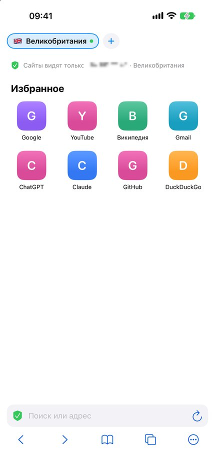
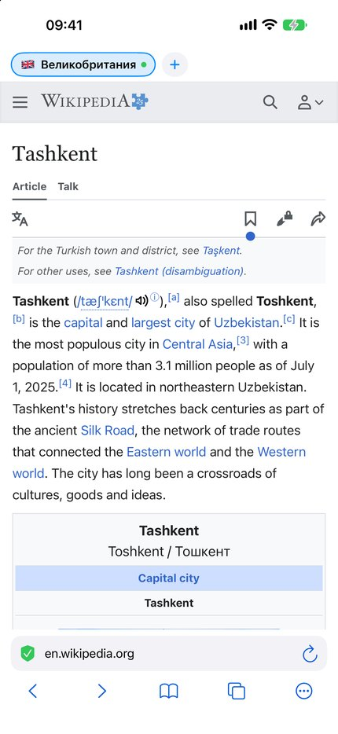
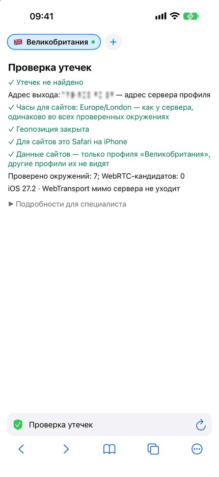
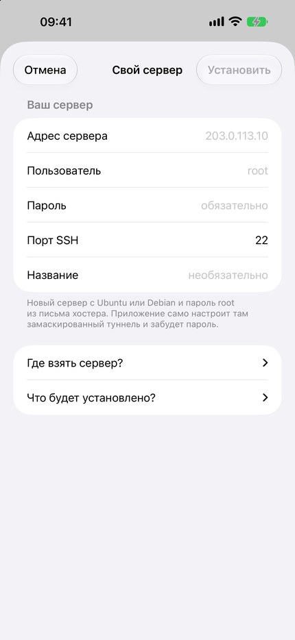

<p align="center">
  
</p>

<h1 align="center">IP Browser</h1>

<p align="center">
  <b>Приватный браузер для iPhone, который ходит через ваш собственный сервер.<br>Страницы и загрузки идут через выбранный сервер; если проверенный маршрут недоступен, браузер ждёт.</b>
</p>

<p align="center">
  <a href="../../actions/workflows/ci.yml"></a>
  
  
  
  
  <a href="LICENSE"></a>
  <a href="https://opensource.org/license/agpl-v3"></a>
</p>

<p align="center">
  <a href="#быстрый-старт">Быстрый старт</a> ·
  <a href="#как-это-устроено">Как устроено</a> ·
  <a href="#что-гарантирует-и-чего-нет">Безопасность</a> ·
  <a href="#ваш-сервер">Ваш сервер</a> ·
  <a href="#вопросы">Вопросы</a> ·
  <a href="README.md">English</a>
</p>

<p align="center">
  
  
  
  
</p>
<p align="center"><sub>Адрес сервера на снимках размыт.</sub></p>

---

## Зачем

VPN-приложение переносит в другую страну весь телефон — почту, мессенджеры, банк — и большинство из них при первом же сбое
туннеля выпускают трафик с вашего настоящего адреса. Браузер с настройкой прокси выдаёт настоящий адрес через WebRTC и похожие
каналы. А нужно часто другое, уже и строже: **один браузер, который всегда «находится» в одной стране, никогда не показывает
ваш адрес и держит входы этой страны отдельно от всего остального** — а остальной телефон живёт как жил.

IP Browser — такой браузер. Вы даёте ему сервер (любой недорогой VPS), он сам настраивает его примерно за полминуты, и дальше
каждая страница уходит с адреса этого сервера — или не уходит вовсе.

## Что умеет

- 🧭 **Сначала браузер.** Главная с избранным и недавними, вкладки с превью, закладки и история (только на телефоне), поиск по
  странице, «Поделиться», загрузки. Сервер, защита и остальное — в **Настройках**.
- 🔒 **Один выход — без исключений.** Страницы и загрузки идут через выбранный сервер. У ядра туннеля внутри приложения нет
  прямого пути в интернет, у прокси WebKit нет запасного пути: если проверенный маршрут недоступен, браузер ждёт.
- ⚡ **Свой сервер за полминуты.** Введите адрес сервера и пароль root, нажмите **Установить**. Приложение подключится по SSH,
  поставит туннель, получит сертификат и забудет пароль. На свежем VPS с Debian 13 ушло 30 секунд.
- 🥷 **Замаскированный туннель, два вида, переключение само.** **HOP** — Hysteria 2 с маскировкой Salamander по UDP с прыжками
  портов; **XHTTP** — VLESS Encryption (ML-KEM-768) поверх XHTTP за небольшим настоящим сайтом на TCP 443. Каждый вид
  должен доказать, что выходит с адреса сервера, прежде чем через него пойдёт страница. Если UDP обрезали на ходу, новые
  страницы сами уходят по TCP (≈2 с для нового сайта).
- 🗂️ **Профиль на каждый сервер — отдельные браузеры в одном приложении.** 🇬🇧 Великобритания, 🇫🇮 Финляндия, 🇺🇸 США… —
  страну приложение определяет само. У каждого свои входы, куки и данные сайтов, вкладки, избранное, история и часы; в профиле
  нет кук и хранилищ другого (признаки самого устройства во всех одинаковы, как и в профилях Safari). Переключение сверху
  одним нажатием.
- 🌍 **Сайты видят местного жителя, а не только чужой адрес.** Часовой пояс сервера в окнах, фреймах и Blob-воркерах страницы
  (service worker сайта и воркеры из отдельного файла видят пояс телефона — [замеры](docs/LEAKS.md)), user agent самого Safari
  и «геопозиция запрещена».
- 🧪 **Встроенная проверка утечек.** *Настройки → Проверка утечек*: WebRTC, WebTransport, ключи входа, часы во всех
  окружениях, ответ о геопозиции и сверка адреса, который видят сайты, с адресом сервера.
- 📶 **Wi-Fi или мобильная, рядом с любым VPN-приложением.** В сетях только с IPv6 (NAT64) приложение набирает адрес, который
  iOS синтезирует для сервера; оба вида проверены через лабораторный NAT64 (64:ff9b::/96), на живом iPhone в такой сети — ещё нет.
- 🤝 **Доступ для другого устройства.** Ключ или QR-код; отозвать можно из приложения.
- 🙈 **Без аккаунтов, аналитики, рекламы и наших серверов.** Приложение говорит только с вашим сервером и сайтами, которые вы открываете.

## Быстрый старт

1. **Поставьте приложение.** В App Store его пока нет: сегодня оно собирается из исходников на Mac с Xcode
   ([как](#сборка-из-исходников)) и ставится на свой iPhone. App Store — скоро.
2. **Есть ключ — уже всё.** Тот, у кого есть сервер IP Browser, может дать вам ключ или QR-код:
   *Серверы → Добавить по ключу или QR*. Свой сервер не нужен.
3. **Или возьмите сервер.** Любой VPS с Ubuntu 22.04/24.04 или Debian 12/13, одним публичным IPv4 и 1 ГБ памяти — обычно
   3–6 $ в месяц. Выбирайте страну, которую должны видеть сайты, и проверьте, что службы геоданных с ней согласны ([почему](#вопросы)).
4. **Установите на него.** *Серверы → Установить на свой сервер* → адрес, пароль → **Установить**. Пользователя можно оставить
   пустым (`root`); подойдёт и пользователь с `sudo`.
5. **Пользуйтесь.** Профиль станет зелёным: «Сайты видят только &lt;ваш сервер&gt;». Откройте что угодно и загляните в
   *Настройки → Проверка утечек*.

Из вашей сети SSH до сервера закрыт? Откройте **веб-консоль** сервера в кабинете хостера и выполните установщик ровно этой версии
приложения — он скачивается по своей контрольной сумме, так что консоль выполнит именно его или ничего:

```sh
curl -fsSLo ipb.sh https://raw.githubusercontent.com/viktorvich/ip-browser/installer-a49ff7d71a17/Server/install.sh && echo "a49ff7d71a17412a79cf09448dcd4e911f15e9112a20f74da64b443290f63010  ipb.sh" | sha256sum -c - && $(command -v sudo) bash ipb.sh install
```

В конце будет ключ и QR-код — добавьте их в приложении.

## Как это устроено


- **Туннель работает внутри приложения**, а не как системный VPN: в него входит только браузер, остальные приложения ходят как
  ходили, любое VPN-приложение на телефоне продолжает работать.
- **Обойти нельзя.** У ядра есть только два выхода — виды вашего сервера; частные и локальные адреса отбрасываются; имена сайтов
  разрешает сервер.
- **Выход проверяется по каждому виду.** До первой страницы, после каждой смены сети и раз в 10 минут приложение спрашивает у
  публичной службы *через каждый вид*, какой адрес видят сайты. Вид с другим адресом закрывает браузер до вашего решения.
- **LocalGate** — единственная дверь, которую знает WebKit. Страницы профиля проходят только через проверенные виды этого
  профиля; отправленное браузером хранится, пока сайт не ответил, и уходит другим видом, если первый замолчал, — но никогда
  не запрос, который уже мог дойти до сайта.
- **Щит** ещё до скриптов страницы убирает возможности WebKit, которые идут мимо прокси (WebRTC, WebTransport, поиск ключей
  входа), и даёт каждому фрейму и воркеру часы сервера. На iOS 26.4–26.x приложение включает ограничения Lockdown самого WebKit.

Подробнее: [устройство и карта кода](docs/ARCHITECTURE.md) · [замеры утечек](docs/LEAKS.md) · [приватность](docs/PRIVACY.md) · [проверки](docs/TESTING.md)

## Что гарантирует и чего нет

| IP Browser гарантирует, что… | …и не обещает |
|---|---|
| каждая страница, её DNS и загрузки уходят только с адреса вашего сервера — или не уходят | скрыть ваши действия от **владельца сервера** (он видит, к каким сайтам вы подключаетесь, но не содержимое HTTPS) |
| каждый вид туннеля доказал свой адрес выхода, прежде чем понёс страницу | анонимность как у Tor: признаки устройства (модель, экран, шрифты) одинаковы во всех профилях, как и в профилях Safari |
| у профилей нет ничего общего: куки, хранилища, кеши, вкладки, история, пароль к локальной двери | провести через туннель системные службы iOS (обновления, проверку сертификатов) — этого не может ни одно приложение |
| WebRTC, WebTransport и поиск ключей входа не выходят в сеть в обход туннеля | защитить другие приложения на телефоне |
| ключ приложения на вашем сервере выполняет одну команду управления — никогда не shell | — |
| пароль уходит только серверу с ключом SSH, который приложение запомнило при первом подключении, или с ровно тем новым ключом, отпечаток которого вы подтвердили | защитить самое первое подключение к новому серверу сверх доверия ему в этот момент — как и сам SSH |
| история, избранное, вкладки, журнал подключения и данные сайтов исключены из резервных копий iCloud и компьютера; журнал, которым делитесь, скрывает адреса | — |

Нашли обход? Сообщите, пожалуйста, закрыто: [SECURITY.md](SECURITY.md).

## Чем отличается

| | IP Browser | VPN-приложение | Браузер + прокси | Tor (Onion Browser) |
|---|:---:|:---:|:---:|:---:|
| Через туннель идёт только браузер | ✅ | ❌ весь телефон | ✅ | ✅ |
| Никогда не выходит с вашего адреса | ✅ по устройству | ⚠️ зависит от kill switch | ⚠️ WebRTC и запасные пути | ✅ |
| Один постоянный адрес и страна | ✅ | ✅ | ✅ | ❌ меняется намеренно |
| Отдельные входы для каждой страны | ✅ профили | ❌ | ❌ | ❌ |
| Работает рядом с другим VPN | ✅ | ❌ на iOS один VPN | ✅ | ✅ |
| Маскировка от блокировок | ✅ Salamander / XHTTP | у некоторых (AmneziaWG) | ❌ | с мостами |
| Свой сервер, настройка с телефона | ✅ | у некоторых (AmneziaVPN) | ❌ | ❌ |

## Ваш сервер

| Что | Как |
|---|---|
| Системы | Ubuntu 20.04 / 22.04 / 24.04, Debian 12 / 13 · x86_64 или arm64 · systemd · один публичный IPv4 |
| Ставит | Hysteria 2.14 (HOP), Xray-core 26.11 (XHTTP), Caddy 2.11 (сайт-обложка и сертификат Let's Encrypt) — официальные выпуски, контрольные суммы закреплены |
| Открывает | UDP 443 и 20000–29999 (HOP), TCP 443/80 (XHTTP) — только если включён файрвол и только то, что добавил сам |
| Управление | `ip-browser-manage add-device / revoke-device / list-devices / status / uninstall`; ключ приложения может только это |
| Удаление | `sudo ip-browser-manage uninstall` — службы, файлы, ключи приложения и ровно те правила файрвола, которые он открыл |

Домен для XHTTP не нужен: сервер получает сертификат Let's Encrypt на свой IP. Если не может (TCP 80 закрыт у провайдера или
занят другой программой), сервер работает только с HOP. На каждую ошибку установщика у приложения свои понятные слова
(закрытый SSH, неверный пароль, занятые порты, нет интернета на сервере…). Проверено на чистых Debian 12 и 13, включая
обновление со старых версий, и на настоящих VPS: [docs/SERVER.md](docs/SERVER.md).

## Вопросы

<details><summary><b>Это VPN?</b></summary>

Нет. Это браузер со своим туннелем внутри. Значка VPN нет, другие приложения не затронуты, любое VPN-приложение можно держать
включённым — страницы браузера всё равно уходят только с вашего сервера.
</details>

<details><summary><b>Нужно знать Linux?</b></summary>

Нет. Нужны адрес сервера и пароль root из письма хостера. Остальное приложение сделает само и простыми словами скажет, что не
так, если что-то пойдёт не так.
</details>

<details><summary><b>Сайт показывает не ту страну, что приложение.</b></summary>

Базы геоданных расходятся по некоторым адресам (блок выдан на одном континенте, используется на другом). Часовой пояс для сайтов
приложение берёт по большинству публичных баз. Чтобы страна была одна для всех, выбирайте сервер, о стране которого базы не
спорят — проверьте адрес на ipinfo.io, ipapi.co и ifconfig.co до покупки.
</details>

<details><summary><b>Работают ли вход Google и проверки Cloudflare?</b></summary>

Да. Сайты видят Safari на iPhone, а не неизвестный встроенный браузер.
</details>

<details><summary><b>Что если сеть режет UDP?</b></summary>

Новые страницы сами уходят по XHTTP (TCP 443), а UDP возвращается, как только снова ответит. Если не проходит ничего,
приложение скажет, какой вид не проходит из этой сети.
</details>

<details><summary><b>Один сервер на несколько телефонов?</b></summary>

Да: *Серверы → QR* → **Ключ для нового устройства**. У каждого устройства свои данные, отозвать можно по одному.
</details>

<details><summary><b>iPad?</b></summary>

Версия 1.0 — приложение для iPhone; на iPad оно запускается как iPhone-приложение.
</details>

## Сборка из исходников

Нужны macOS с Xcode 26+, Go 1.27 и [XcodeGen](https://github.com/yonaskolb/XcodeGen). Сначала укажите в `project.yml` свою команду
(`DEVELOPMENT_TEAM`) и идентификатор (`PRODUCT_BUNDLE_IDENTIFIER`) — проект генерируется из него.

```sh
tools/build-libxray.sh     # Vendor/LibXray.xcframework из XTLS/libXray (gomobile, Go и go.sum закреплены)
xcodegen generate
tools/pin-packages.sh      # пакеты Swift ровно как в tools/Package.resolved
open IPBrowser.xcodeproj
```

`tools/ci.sh` делает то же, что CI: shellcheck серверных скриптов, сборку и модульные тесты в симуляторе. Вся жизнь сервера
проверяется в одноразовой виртуальной машине (`tools/vm-test.sh`), настоящие прогоны — лаб-крючками отладочной сборки:
[docs/TESTING.md](docs/TESTING.md).

## Участие

Issue и pull request приветствуются — сначала прочитайте [CONTRIBUTING.md](CONTRIBUTING.md). Уязвимости — через [SECURITY.md](SECURITY.md).

## Благодарности

IP Browser стоит на [Xray-core](https://github.com/XTLS/Xray-core) и [libXray](https://github.com/XTLS/libXray),
[Hysteria](https://github.com/apernet/hysteria), [Caddy](https://github.com/caddyserver/caddy), Apple
[SwiftNIO](https://github.com/apple/swift-nio), [SwiftNIO SSH](https://github.com/apple/swift-nio-ssh) и
[Swift Crypto](https://github.com/apple/swift-crypto). Их лицензии: [App/Resources/licenses.txt](App/Resources/licenses.txt).

## Лицензия

IP Browser — открытый проект с двойной лицензией:

1. **Open source:** [GNU Affero General Public License v3.0 или более поздняя](LICENSE) (AGPL-3.0-or-later). Любой может
   пользоваться, изучать, менять и делиться. Изменённую версию, которую вы даёте другим (как приложение или как сетевой
   сервис), нужно отдавать с полным исходным кодом под той же лицензией.
2. **Коммерческая:** отдельная лицензия для тех, кому AGPL не подходит, например для закрытого продукта. Напишите в
   [issues](https://github.com/viktorvich/ip-browser/issues).

Copyright © 2026 viktorvich. Название «IP Browser» и значок не входят ни в одну из лицензий: изменённой версии нужны своё имя
и свой значок. Версии, опубликованные до 21 ноября 2026 года, распространяются по лицензии MIT. Встроенные компоненты — под
своими лицензиями (MPL-2.0, MIT, Apache-2.0, BSD, LGPL-3.0 с исключением для статической сборки).
